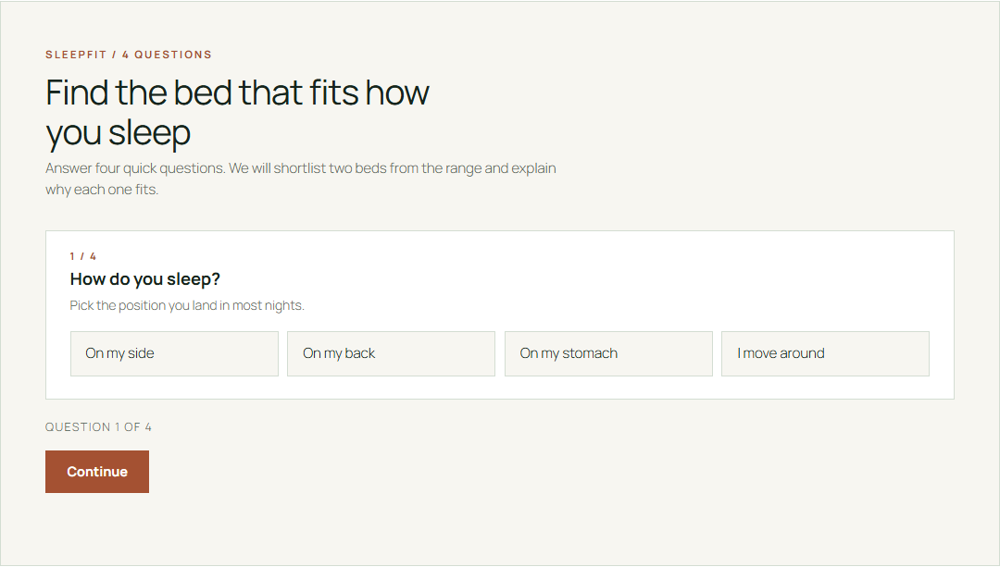
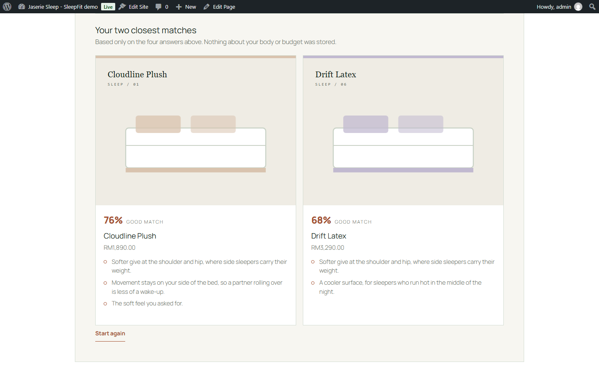

# SleepFit — a guided mattress finder for WooCommerce

> Four questions, two matched beds, one honest explanation. A WordPress plugin that turns a sleep brand's catalogue into a product finder instead of another filter sidebar.

[](https://www.php.net/)
[](https://woocommerce.com/)
[](tests/run.php)
[](LICENSE)

## Live demo

**[Open the demo store in WordPress Playground](https://playground.wordpress.net/?blueprint-url=https://raw.githubusercontent.com/kiwiiiiiiiiiiiiiiiiiiiiiiiiiiiii/sleepfit/main/blueprint.json)**

It boots a real WordPress + WooCommerce install, installs this plugin, seeds six sleep products with attributes, and lands on the finder page. No signup, no server. It takes about a minute to boot.

| Question step | Results |
| --- | --- |
|  |  |

## The problem

A sleep store makes people choose between twenty near-identical mattresses. Specs like "medium firm", "pocket sprung" and "cooling" mean nothing to someone who just wants to stop waking up hot. Most stores answer with a product grid and a filter widget.

SleepFit asks what kind of sleeper you are, then ranks the real catalogue against that answer using attribute data the merchant already has. It shows two beds, not twenty, and explains the shortlist in plain language.

## How it works

1. Four questions: sleep position, preferred firmness, temperature, and who shares the bed.
2. Each answer builds a target map across four dimensions: firmness, support, cooling and motion isolation.
3. Every published, in-stock product is scored against that map. Adjacent values get partial credit (firm → medium-firm = 0.45). Missing attribute data gets half credit, so a half-filled catalogue does not produce nonsense.
4. The top two are shown with a match score and up to three reasons drawn from the same data that produced the score.
5. Optionally, one short AI-written line is generated for the top result. The AI is a finishing touch, never the decision maker.

The scoring model is deliberately transparent and testable. There is no hidden prompt deciding which bed you get.

| Dimension | Weight | Why |
| --- | --- | --- |
| Firmness | 1.0 | The preference shoppers can actually articulate |
| Support | 1.0 | Position-specific: side → pressure relief, stomach → firm support |
| Cooling | 0.8 | Decides satisfaction for hot sleepers |
| Motion isolation | 0.6 | Dropped entirely for solo sleepers, so they are not upsold |

## AI layer, with the guardrails on

The AI call is optional and fails closed. If there is no key, a provider timeout, a non-200 response, or a reply containing a medical claim, the shopper still gets the deterministic reasons.

- One call per request, top result only
- 6 second timeout, zero redirects, https only
- Cache keyed on answers + product + model + prompt version, 30 days
- OpenAI-compatible endpoint, so it works with OpenAI, Groq, OpenRouter or a local model
- Key read from `SLEEPFIT_AI_KEY` in `wp-config.php` first, database field second
- Output stripped of markup, capped to two sentences / 240 characters

## Privacy

The events table stores four answer slugs, a product ID and a score. **No IP address, no user ID, no session ID, no user agent.** It exists so a merchant can see "side sleepers who run hot picked the AeroCool Hybrid 34 times", not to track people. Recording can be switched off, and uninstall can delete the table.

## Architecture

```
sleepfit.php                  Bootstrap, activation, HPOS compatibility
includes/
  class-scoring.php           Pure scoring model and question schema (no WP calls)
  class-matcher.php           Reads WooCommerce products, ranks, shapes payload
  class-rest.php              POST /wp-json/sleepfit/v1/match, rate limit
  class-llm.php               Optional explanation provider + cache + fallbacks
  class-events.php            Custom table, anonymous aggregates
  class-shortcode.php         Server-rendered finder, works without JS
  class-admin.php             WooCommerce settings + 30-day report
  class-plugin.php            Asset registration, i18n
assets/                       Vanilla JS and scoped CSS, no jQuery, no build step
demo/seed.php                 Six products + attributes for the Playground demo
tests/run.php                 Dependency-free test runner
blueprint.json                One-click live demo
```

**Why the core has no WordPress calls:** the ranking logic is where subtle mistakes live. `tests/run.php` loads `class-scoring.php` with a translation stub and exercises ranking, partial credit, validation and normalisation outside a full WordPress boot.

## Install

1. Copy the plugin folder to `wp-content/plugins/sleepfit`.
2. Activate **SleepFit** in WordPress (WooCommerce must be active).
3. Add `[sleepfit]` to any page.
4. Go to **WooCommerce → SleepFit** and map your attribute slugs. Defaults assume `pa_firmness`, `pa_support`, `pa_cooling`, `pa_motion`.

Optional AI:

```php
// wp-config.php
define( 'SLEEPFIT_AI_KEY', 'sk-...' );
```

Then enable it in the settings page and point the base URL at any chat-completions compatible provider.

## Tests

```bash
php tests/run.php
# 26 passed, 0 failed
```

Lint every file:

```bash
find . -name '*.php' -exec php -l {} \;
```

## Honest limitations

- Reads attributes from the parent product, not individual variations. A variable product with variation-specific firmness needs a small extension hook (`sleepfit_matches`).
- The limiter is a WordPress transient per IP, not an edge-level rate limiter.
- The reason copy is in English; the strings are translatable, but no translations ship yet.
- No build step means no minification. JS and CSS together are about 10 KB uncompressed.

## One-line description

A WooCommerce mattress finder that scores real products against four sleep questions and explains each match — with a cached, fail-closed AI layer.
